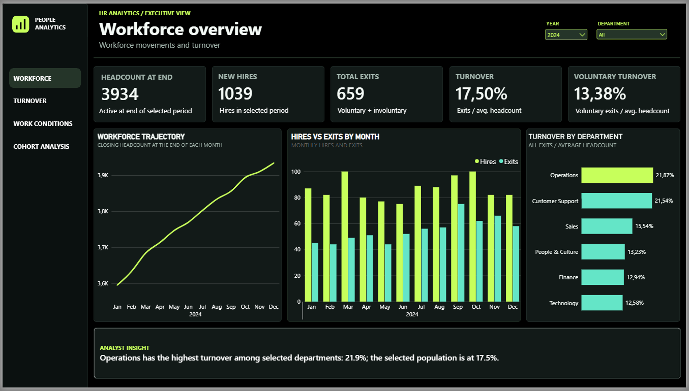
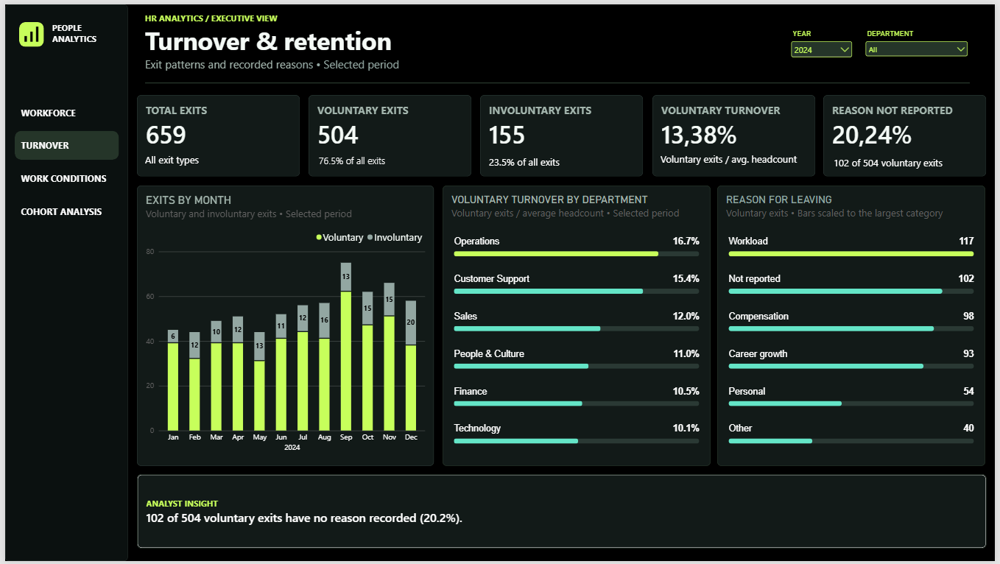
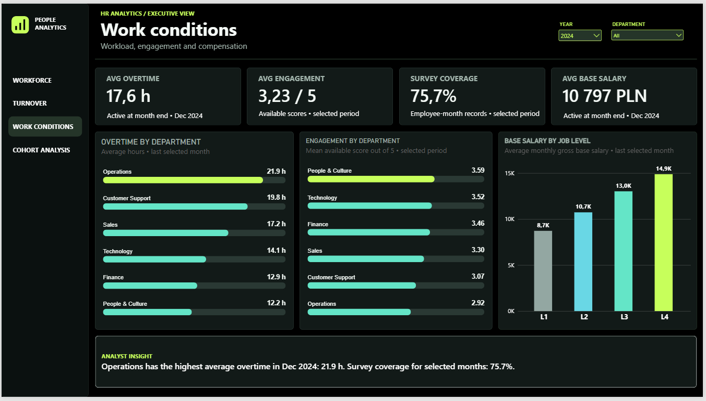
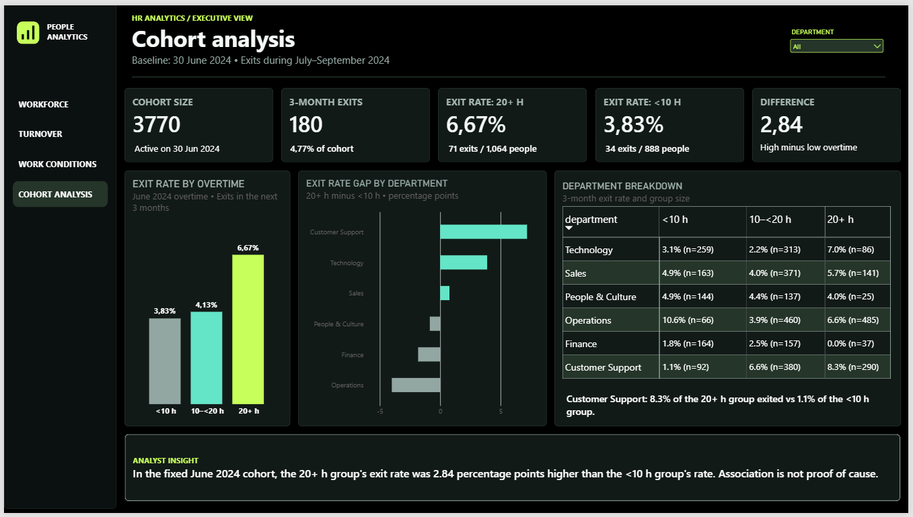

# HR Analytics | SQL Server & Power BI

An end-to-end workforce analytics project exploring employee movement, turnover and working conditions in a fictional company. The project uses **SQL Server and T-SQL** for data quality checks, transformation and analysis, with **Power BI** for interactive reporting.

> **Data note:** This project uses synthetic data. The employees, departments, salaries and outcomes do not represent a real organisation.

**Tools:** SQL Server · T-SQL · Power BI · DAX · Python · Deneb

---

## Project at a glance

| | |
|---|---|
| Business question | Where should a fictional organisation start investigating workforce turnover and working conditions? |
| Period | January 2023–December 2025 |
| Data | 6,147 fictional employees, 6 departments and 137,040 employee-month records |
| Approach | CSV validation → SQL staging → cleaning and quality checks → analysis → Power BI reporting |
| Reporting | Four pages: Workforce Overview, Turnover & Retention, Work Conditions and Cohort Analysis |

The focus is on building a reliable analytical workflow: understanding the grain of each table, checking data quality, defining measures consistently and interpreting results in context.

## Report preview

The images below are screenshots of the Power BI report. The first three pages show **2024** with all departments selected. The cohort page has a fixed June–September 2024 observation window.

### 1. Workforce overview

Tracks closing headcount, hires, exits and turnover, with monthly trends and a comparison by department.



### 2. Turnover & retention

Separates voluntary and involuntary exits and explores recorded reasons for voluntary departures. Missing reasons remain visible as their own category.



### 3. Work conditions

Compares overtime, available engagement scores, survey coverage and gross base salary across departments and job levels.



### 4. Cohort analysis

Follows employees active on 30 June 2024 and compares their June overtime with exits during the following three months. The department breakdown includes group sizes to help interpret the rates.



## Selected findings

The findings below describe the **synthetic dataset**, with all departments selected.

- **Workforce movement in 2024:** 1,039 hires and 659 exits resulted in a closing headcount of **3,934**. Turnover for the year was **17.50%**, including **13.38%** voluntary turnover.
- **Department differences in 2024:** Operations recorded **21.87%** turnover and Customer Support **21.54%**, compared with **17.50%** for the company. These differences identify areas for further investigation; they do not establish why employees left.
- **Exit-reason completeness:** 102 of 504 voluntary exits in 2024 had no recorded reason (**20.24%**). Workload was recorded for 117 voluntary exits. Missing reasons are retained when calculating the share.
- **Working conditions:** in December 2024, employees active at month end averaged **17.6 overtime hours** and **PLN 10,797** in monthly gross base salary. Across 2024, engagement scores were available for **75.7% of employee-month records**.
- **Fixed cohort:** among 3,770 employees active on 30 June 2024, 180 exited during July–September. The exit rate was **6.67%** for employees with 20+ overtime hours in June (71/1,064) and **3.83%** for those with fewer than 10 hours (34/888): a difference of **2.84 percentage points**.

The cohort pattern varies by department. For example, Operations shows **6.6%** in the 20+ hour group versus **10.6%** in the under-10-hour group; the latter contains only 66 people. This is an unadjusted comparison, not evidence that overtime caused an exit.

## Analytical workflow

1. **Validate the source files.** Inspect row counts, keys, duplicate employee-month records, data types and missing values before loading.
2. **Load the staging layer.** Import the complete CSV extracts into the `stg` schema. The Python loader validates the files first and replaces staging data within a transaction.
3. **Clean and standardise in SQL.** Use analytical views to convert types, standardise labels and make missing exit reasons explicit while retaining raw staging data.
4. **Explore workforce movement.** Use joins, CTEs, conditional aggregation and window functions to analyse hires, exits, headcount and departmental turnover.
5. **Build a time-ordered cohort.** Measure overtime in June 2024, then observe any exit from July through September 2024. Compare the overall result with department-level groups and their sizes.
6. **Create the reporting layer.** Use SQL views and a Power BI model with DAX measures to present the results and respond to filters.

### SQL techniques demonstrated

| Technique | How it is used |
|---|---|
| Joins and CTEs | Combine employee, department and monthly data into analysis-ready datasets |
| `CASE`, `TRY_CONVERT`, `NULLIF` | Standardise labels, convert raw text and handle missing or invalid values |
| Conditional aggregation | Calculate hires, exits, headcount and survey coverage |
| `LAG` and rolling windows | Compare months and calculate a rolling three-month turnover measure |
| `DENSE_RANK` | Rank departments by turnover rate |
| `PERCENTILE_CONT` | Compare median and mean base salaries by department |
| SQL quality checks | Test keys, workforce reconciliation, monthly continuity and cohort follow-up completeness |

### Example: rank departments by 2024 turnover

This example is adapted from the advanced SQL analysis. It ranks departments by **exits relative to average headcount**, rather than by the number of exits alone.

```sql
WITH department_year AS (
    SELECT
        department,
        SUM(exits) AS exits,
        AVG(average_headcount) AS avg_headcount
    FROM analytics.vw_department_monthly_kpi
    WHERE month_end >= '20240101'
      AND month_end <  '20250101'
    GROUP BY department
), rates AS (
    SELECT
        department,
        exits,
        100.0 * exits / NULLIF(avg_headcount, 0) AS turnover_pct
    FROM department_year
)
SELECT
    DENSE_RANK() OVER (ORDER BY turnover_pct DESC) AS turnover_rank,
    department,
    exits,
    CAST(turnover_pct AS decimal(8, 2)) AS turnover_pct
FROM rates
ORDER BY turnover_rank, department;
```

See the full workflow in [`sql/08_analiza_zaawansowana.sql`](sql/08_analiza_zaawansowana.sql).

## Data model and metric definitions

### Source data

| File | One row represents | Rows |
|---|---|---:|
| [`departments.csv`](data/departments.csv) | One fictional department | 6 |
| [`employees.csv`](data/employees.csv) | One fictional employee | 6,147 |
| [`monthly_snapshots.csv`](data/monthly_snapshots.csv) | One employee present during one month | 137,040 |

An employee can appear in several monthly snapshots. An employee who exits during a month is still included in that month's snapshot.

### Power BI relationships

| Dimension | Related table | Key |
|---|---|---|
| `DimEmployee` | `FactMonthly` | `employee_id` |
| `DimMonth` | `FactMonthly` | `month_end` |
| `DimEmployee` | `CohortJune2024` | `employee_id` |

Department filters flow from the employee dimension. The cohort is fixed: the `DimMonth` year filter does not change its June–September 2024 window.

### Key definitions

| Metric | Definition |
|---|---|
| Closing headcount | Employees in the last selected monthly snapshot who did not exit during that month |
| Monthly average headcount | `(opening headcount + closing headcount) / 2` |
| Period turnover | Exits during the period / average of the monthly average headcounts in that period |
| Voluntary turnover | Voluntary exits / period average headcount |
| Survey coverage | Employee-month records with an engagement score / all employee-month records in the same context |
| Cohort exit rate | Cohort members who exited in July–September 2024 / members in the relevant baseline group |

When several years are selected, period turnover covers the **whole selected period**; it is not an annual rate. Cohort exit rates use the baseline group as the denominator and should not be confused with period turnover.

## SQL project files

| File | Purpose |
|---|---|
| [`01_setup.sql`](sql/01_setup.sql) | Create the database, schemas and staging tables |
| [`02_quality_checks.sql`](sql/02_quality_checks.sql) | Inspect source quality and missing values |
| [`03_clean_views.sql`](sql/03_clean_views.sql) | Create typed and standardised analytical views |
| [`04_eda.sql`](sql/04_eda.sql) | Explore workforce data and reconciliation |
| [`05_business_questions.sql`](sql/05_business_questions.sql) | Analyse turnover, reasons and compensation |
| [`06_cohort_hypothesis.sql`](sql/06_cohort_hypothesis.sql) | Compare the overtime cohort and departments |
| [`07_reporting_views.sql`](sql/07_reporting_views.sql) | Create monthly company and department KPI views |
| [`08_analiza_zaawansowana.sql`](sql/08_analiza_zaawansowana.sql) | Rolling rates, rankings, median salary and cohort comparison |
| [`09_testy_sql.sql`](sql/09_testy_sql.sql) | Check integrity, continuity and cohort follow-up |

## Reproduce the SQL analysis

**Requirements:** SQL Server, SQL Server Management Studio, Python, `pyodbc`, and Microsoft ODBC Driver 17 or 18 for SQL Server. The supplied loader uses Windows authentication.

1. Run [`sql/01_setup.sql`](sql/01_setup.sql) in SSMS to create `HR_Analytics`, the schemas and staging tables if needed.
2. Open a PowerShell terminal in the project root and run:

   ```powershell
   python -m pip install pyodbc
   python scripts/validate_data.py
   python scripts/load_to_sql.py --server "YOUR_SQL_SERVER_NAME"
   ```

   Replace `YOUR_SQL_SERVER_NAME` with the server name used in SSMS. The loader expects the complete CSV extracts and **replaces the contents of this project's staging tables** in one transaction. If Python is not on `PATH`, use the full path to `python.exe`.

3. In SSMS, run `sql/02_quality_checks.sql` through `sql/09_testy_sql.sql` in order. Review the result sets and the comments in each file.
4. The screenshots show the Power BI report. 

## Limitations and interpretation

- The data are synthetic. The generator deliberately embeds some relationships between working conditions and exit probability, so patterns in this project are not evidence about a real workforce.
- Cohort comparisons are exploratory and unadjusted. Department mix and other factors can affect the overall result; some department groups are small.
- Engagement is measured only where a score is present. Across the complete dataset, **32,816 of 137,040 employee-month records** have no engagement score; missing scores are not treated as zero.
- The recorded exit reason is a category in the dataset, not proof of an underlying cause. Base salary represents simulated contracted gross pay, not total employer cost.
- Department and job level are simplified and do not model transfers, promotions or rehires.

The project is intended to demonstrate SQL analysis, metric design and reporting—not to support decisions about real employees.

